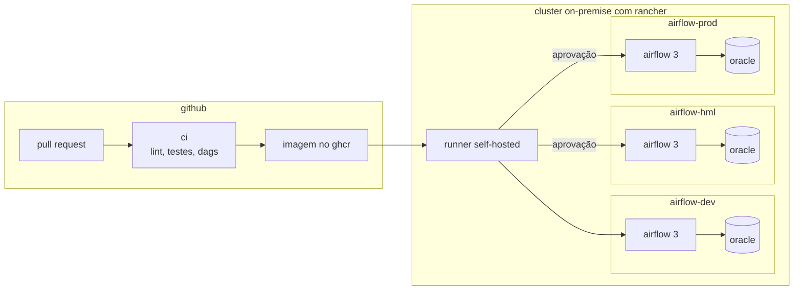

# esteira de dados no airflow 3

Orquestração e entrega do pipeline de preços da ANP: DAGs no **Airflow 3**, imagem Docker própria, ambientes **dev, hml e prod** no **Kubernetes gerenciado pelo Rancher** e promoção entre ambientes **só por pull request aprovado**.

Este repositório faz parte de um conjunto de três:

| repositório | papel |
|---|---|
| [precos-anp](../precos-anp) | o pipeline: leitura, validação e carga dimensional no Oracle |
| [qualidade-anp](../qualidade-anp) | checagens de qualidade, alertas, fichas dos processos e laboratório de incidentes |
| **esteira-anp** | orquestração, imagem, ambientes, ci/cd e operação |

## arquitetura



## dags

**precos_anp**, toda segunda às 06:00


- `preparar_estrutura`: garante que as tabelas existem
- `carregar_arquivo`: baixa o semestre e roda o pipeline; se o arquivo não mudou, pula
- `verificar_qualidade`: roda as checagens; falha crítica derruba a execução e aviso manda alerta

Parâmetros: `ano`, `semestre` e `reprocessar`. Sem parâmetros, carrega o semestre atual. Retries com espera de 5 minutos e alerta no Telegram em qualquer falha.

**monitor_precos_anp**, de hora em hora: avisa quando a última carga com sucesso passou do limite.

## organização do código

As DAGs só ligam as tarefas. A lógica fica no pacote `tarefas`, que usa os pacotes `anp` e `qualidade`:

```
dags/precos_anp.py              → define a ordem e as regras de execução
tarefas/precos_anp.py           → o que cada tarefa faz
precos-anp/anp/...              → pipeline de dados
qualidade-anp/qualidade/...     → checagens, alertas e monitor
```

Uma falha no fundo do pipeline aparece no log da tarefa com o caminho inteiro: `tarefas` → `anp.pipeline` → `anp.leitor`. O laboratório de incidentes no `qualidade-anp` mostra como seguir esse rastro.

## imagem

A imagem parte do `apache/airflow:3.1.0` e leva os três projetos. O build é feito na pasta que contém os três repositórios lado a lado:

```bash
docker build -f esteira-anp/Dockerfile -t esteira-anp:local .
```

## ambientes

| | dev | hml | prod |
|---|---|---|---|
| namespace | `airflow-dev` | `airflow-hml` | `airflow-prod` |
| publicação | automática no merge | após aprovação | após aprovação |
| dags novas | pausadas | pausadas | ativas |
| scheduler | 1 réplica | 1 réplica | 2 réplicas |

Cada ambiente tem o próprio Oracle e o próprio segredo `anp-oracle`, criado a partir do `.env.<ambiente>`, que nunca vai para o git.

- fluxo completo de mudança: [docs/fluxo-de-mudanca.md](docs/fluxo-de-mudanca.md)
- operação do dia a dia: [docs/operacao.md](docs/operacao.md)

## rodar na sua máquina

Requisitos: [Rancher Desktop](https://rancherdesktop.io) com Kubernetes ligado, `kubectl` e `helm`.

```bash
cp .env.exemplo .env.dev
./scripts/subir_ambiente.sh dev
docker build -f esteira-anp/Dockerfile -t ghcr.io/fwlipesantos/esteira-anp:local ..
./scripts/deploy.sh dev local
kubectl -n airflow-dev port-forward svc/airflow-api-server 8080:8080
```

A interface fica em `http://localhost:8080`.

## testes

```bash
pip install "apache-airflow==3.1.0" --constraint "https://raw.githubusercontent.com/apache/airflow/constraints-3.1.0/constraints-3.12.txt"
pip install -r requirements-dev.txt
pytest
```

Os testes carregam as DAGs de verdade no Airflow 3 e conferem que não há erro de importação, que a ordem das tarefas está certa, que toda tarefa tem dono e retry e que toda DAG tem ficha de documentação no `qualidade-anp`.
