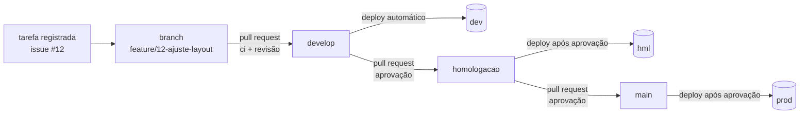

# fluxo de mudança

Nenhuma mudança vai direto para produção. Todo código passa pelos três ambientes, sempre por pull request aprovado.

| etapa | o que acontece |
|---|---|
| tarefa | toda mudança nasce de uma issue, que registra o motivo |
| branch | criada a partir da `develop`, com o número da tarefa no nome |
| pull request | o modelo pede a tarefa, o que muda e como foi testado; o ci barra o pull request sem tarefa vinculada |
| ci | lint, testes do pipeline, testes de qualidade, validação das dags e build da imagem |
| dev | o merge na `develop` publica a imagem e faz o deploy sozinho |
| hml | o merge na `homologacao` só publica depois da aprovação no environment `hml` |
| prod | o merge na `main` só publica depois da aprovação no environment `prod` |

## configuração no github

Em **Settings → Environments**, criar `dev`, `hml` e `prod`. Em `hml` e `prod`, marcar **Required reviewers**.

Em **Settings → Branches**, proteger `develop`, `homologacao` e `main`, exigindo pull request e o ci passando.

O deploy roda num **runner self-hosted**, instalado numa máquina que enxerga o cluster. Como o ambiente é on-premise, o GitHub não alcança o cluster diretamente: o runner faz essa ponte. Ele precisa ter `kubectl`, `helm` e acesso ao cluster configurado.
